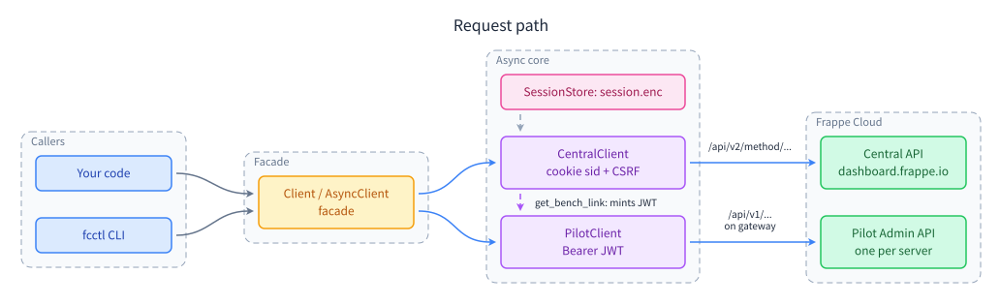
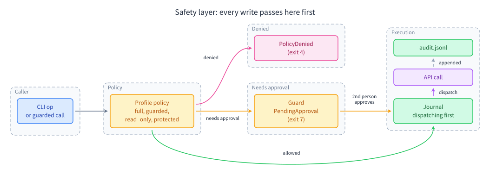
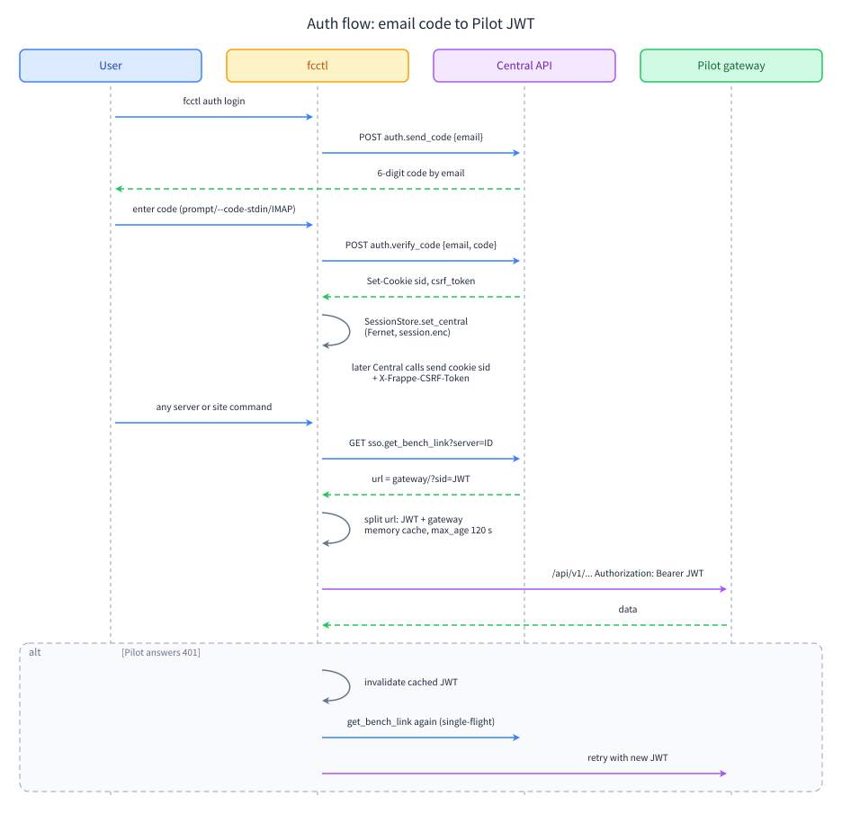
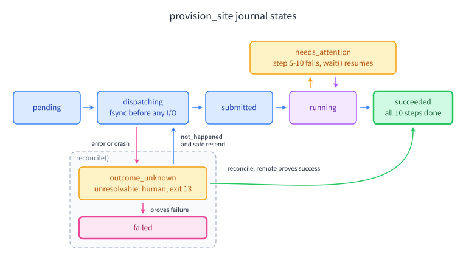
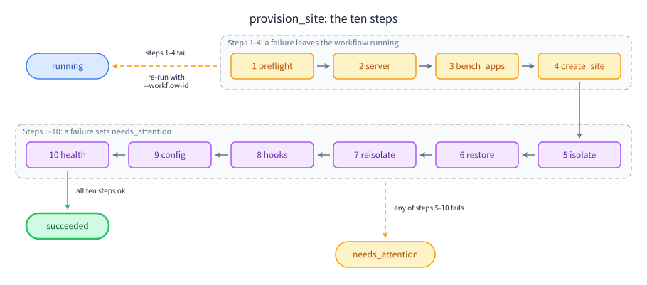
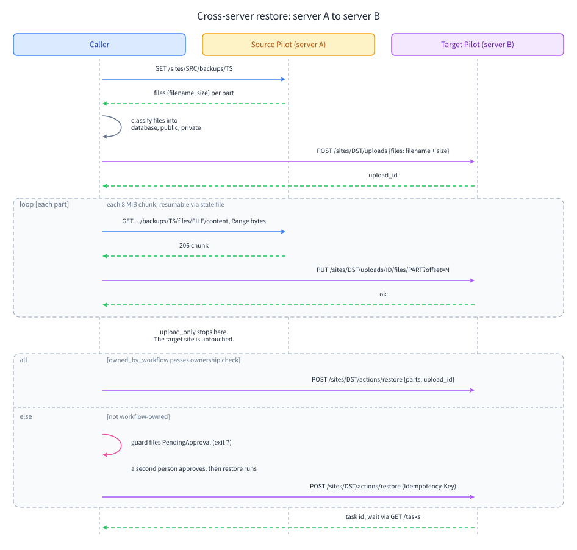
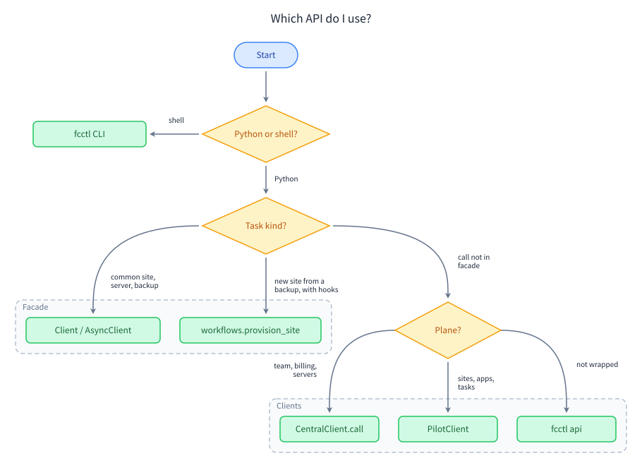

# fcctl architecture

How fcctl is put together, for someone reading the code for the first time. Diagrams are SVG files under `docs/assets/`. Back to the [README](../README.md).

## 1. Components

Two front doors (the CLI and the `Client` / `AsyncClient` facade) sit on one async core with two clients: `CentralClient` (team, billing, server lifecycle; cookie `sid` + CSRF) and `PilotClient` (sites, apps, tasks on a server gateway; Bearer JWT minted through Central). Writes pass the safety layer first: the profile policy (`full`, `guarded`, `read_only`, `protected` plus an `allow` list from `config.toml`) decides, the guard files an approval request when needed (a speed bump, not a two-person control), and the journal records `dispatching` before the API call. The CLI wires this in `fcctl/ops.py`; the facade uses `@guarded` wrappers in `_async`.

**Request path.**

**Safety layer** (every write goes through this before an API call).

Code generation: `fcctl/_sync` is generated from `fcctl/_async` by `scripts/gen_sync.py` (unasync); edit `_async` only. Legacy `fcctl.servers`, `fcctl.sites`, ... are thin re-exports of `_sync`.

## 2. Auth flow

Login is by email code, giving a Central `sid` cookie (stored Fernet-encrypted in `$FCCTL_HOME/session.enc`, keyed by `FCCTL_KEY`). Pilot never sees the `sid`: `PilotClient` calls Central `sso.get_bench_link?server=ID`, gets back `<gateway>/?sid=<JWT>`, and uses that JWT as a Bearer token. Pilot JWTs are cached in memory only, for 120 s by default, and minted single-flight per server. A Pilot 401 re-mints once. A Central auth failure goes to the reauth chain (refresh CSRF, re-mint the Pilot link, then the alerter and `ReauthFailed`; run `fcctl auth login` again). Persisted state (session, approvals, journal, audit) lives under `$FCCTL_HOME`, created 0700, files 0600; Pilot JWTs are never written to disk.

## 3. `provision_site` workflow

`provision_site` is one journal entry whose id is the workflow id. It is created `pending`, then immediately moved to `dispatching`, `submitted`, `running` before step 1 starts. Eleven steps run in order and each completed step is recorded, so a re-run with the same `--workflow-id` skips what is done. A failure in steps 1-4 (preflight through create_site) leaves the entry `running` and resumable; a failure in steps 5-11 (isolate onward) moves it to `needs_attention`, and `wait()` moves it back to `running` and continues. `isolate` turns on `maintenance_mode` and `pause_scheduler`; `reisolate` reapplies them after the restore. `release` (after `hooks` and `config`, before `health`) sets both back to 0 unless `keep_isolated=True`; it writes nothing if a template hook already lifted them. Journals written before `release` existed run it on resume. The builtin hooks `core.set_host_name` and `core.set_fresh_encryption_key` always raise `UsageError`, because Pilot protects `host_name` and `encryption_key`. The `restore` step only runs on a site the workflow itself created less than 1 h ago (ownership check), otherwise it raises `PolicyDenied`.

`dispatching` is written (fsync) before any network call. If the call then raises or the process dies, the entry becomes `outcome_unknown` and is never retried silently. `fcctl reconcile --once` (or `fcctl watch`) asks the remote what really happened: it settles the entry as `succeeded` or `failed`, or, only when the remote proves it did not happen and the op's idempotency class allows a safe resend, resubmits it. Otherwise it stays `outcome_unknown` for a human (exit 13). A `dispatching` entry younger than 5 minutes is skipped. Note the `outcome_unknown` arrows come from the guarded-op path (`journal.execute`, used by CLI `run_op`, which wraps the whole `site provision` command in its own `site.create` entry), not from the workflow's own step entry. The workflow's step entry itself only uses `running`, `needs_attention`, `succeeded`.

**Journal states.**

**The eleven steps** (each recorded in the journal; a re-run skips finished steps).

## 4. Cross-server restore via upload

Used by `client.backups.restore(from_site_backup=...)` and the provision `restore` step. fcctl streams the backup files from the source server into a chunked upload on the target (constant memory, one 8 MiB chunk at a time, HTTP `Range` on the source). Progress is kept in a state dict or file (`upload_id` plus per-part offsets), so a re-run resumes. Uploading does not touch the target site. Only the final `actions/restore` overwrites it, and that call is guarded: it returns a `PendingApproval` unless `owned_by_workflow` names a workflow that created the site.

## 5. Which API do I use?

Rule of thumb: start at the top and stop at the first match. Raw `fcctl api` calls are classified, audited and guarded like any other write, so they are a safe escape hatch, not a way around the guard.

## Where to read next

- [API_IA.md](API_IA.md): full method catalogue, Central vs Pilot per method.
